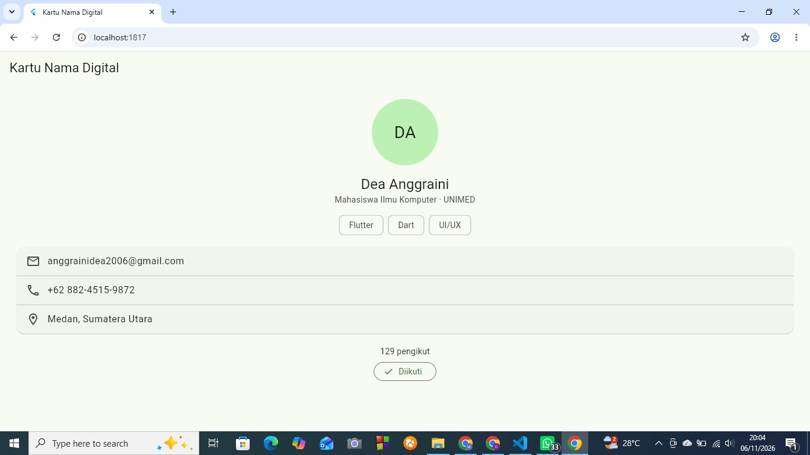
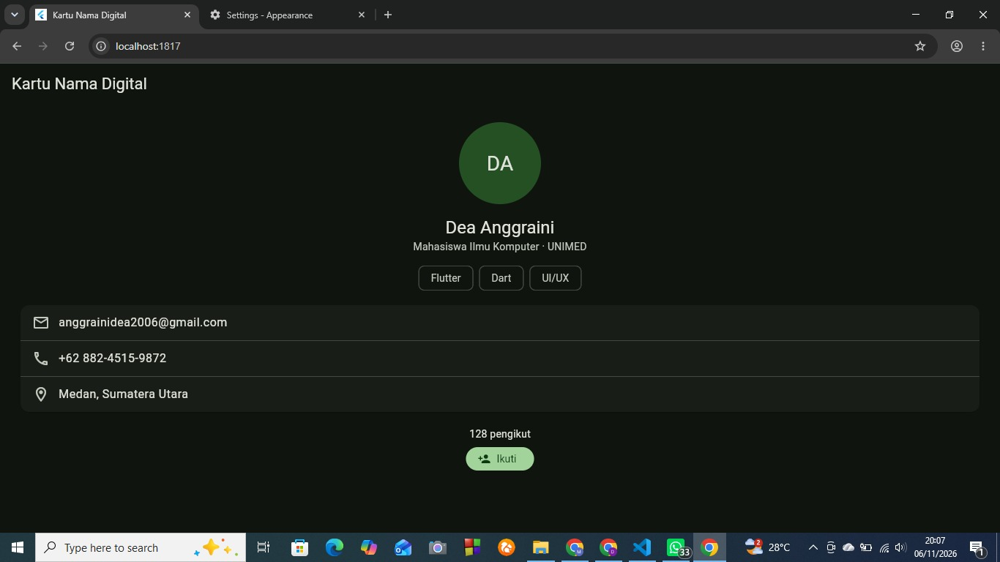
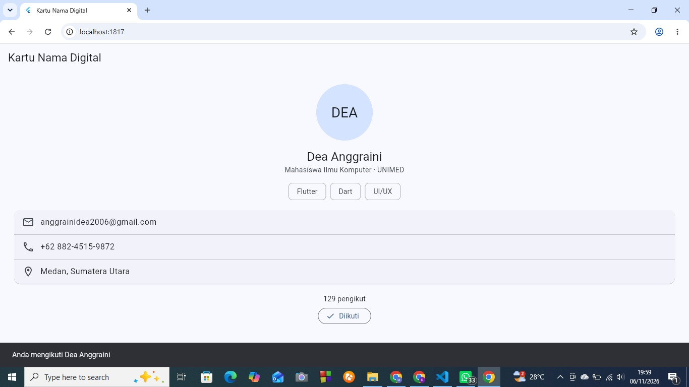
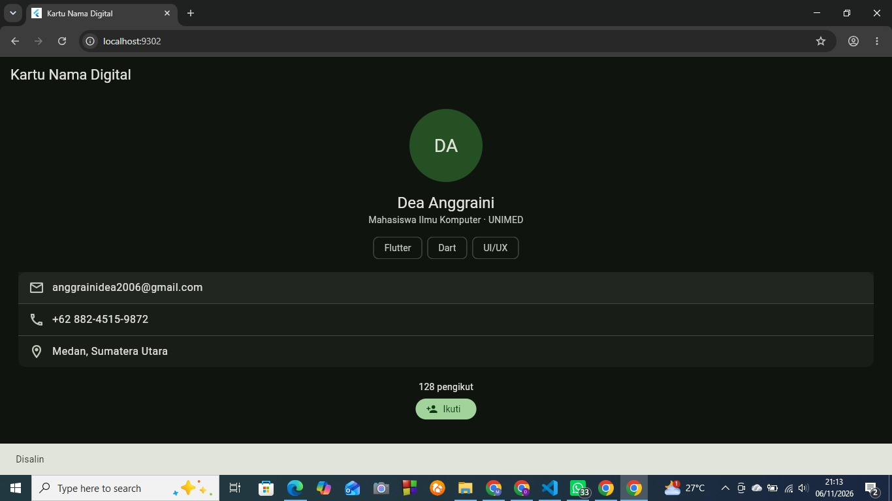
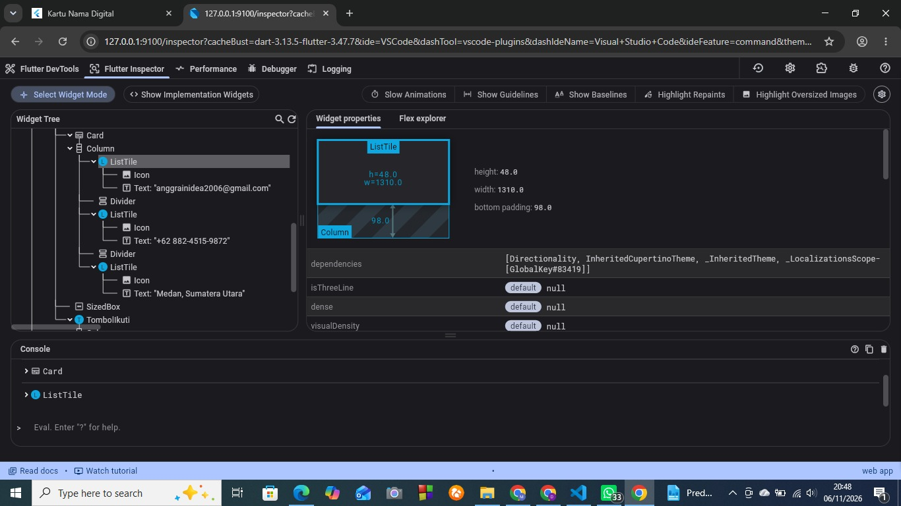

# Kartu Nama Digital

Praktikum Pertemuan 5 - Pemrograman Mobile (3KOM40215)
Pengantar Flutter & Widget Basics dengan Material Design 3

## Identitas

- Nama: Dea Anggraini
- NIM: 4243250051
- Program Studi: Ilmu Komputer, FMIPA, Universitas Negeri Medan
- Dosen Pengampu: Adidtya Perdana, S.T., M.Kom

## Deskripsi

Aplikasi satu halaman berisi kartu nama digital: avatar inisial, nama, deskripsi singkat, chip keahlian, kartu kontak (email, telepon, lokasi), dan tombol Ikuti dengan jumlah pengikut.

## Fitur

- Tema Material 3 dari satu seed color (`ColorScheme.fromSeed`), lengkap dengan `darkTheme` yang mengikuti pengaturan sistem.
- Halaman profil dibuat `StatelessWidget`; hanya `TombolIkuti` yang `StatefulWidget`.
- Tombol Ikuti memakai `setState` untuk mengubah label dan jumlah pengikut, lalu menampilkan `SnackBar`.
- Tantangan 3: setiap baris kontak dapat ditekan dan menampilkan SnackBar "Disalin" (tanpa benar-benar menyalin).
- Satu widget test untuk memeriksa tombol Ikuti.

## Widget yang Digunakan

Scaffold, AppBar, SingleChildScrollView, Column, CircleAvatar, Text, SizedBox, Wrap, Chip, Card, ListTile, Divider, FilledButton, OutlinedButton, SnackBar.

## Tangkapan Layar

| Mode Terang | Mode Gelap |
|---|---|
|  |  |

| Tombol Ikuti | Tantangan 3 (SnackBar Disalin) |
|---|---|
|  |  |

Widget Inspector (jalur Scaffold > SingleChildScrollView > Column > Card > Column > ListTile):

## Cara Menjalankan

1. Pastikan Flutter terpasang (`flutter doctor`).
2. Jalankan `flutter pub get`.
3. Jalankan `flutter run -d chrome`.
4. Untuk menjalankan tes: `flutter test`.

## Catatan

- Perangkat uji: Chrome (web).
- Impor memakai `package:material_ui/material_ui.dart` sesuai modul.